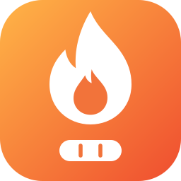

<p align="center"></p>

# MCZ Maestro (cloud) pour Home Assistant

[](https://github.com/Alardware/mcz-maestro/actions)
[](https://hacs.xyz/docs/faq/custom_repositories/)
[](https://ko-fi.com/alardware)

Intégration Home Assistant pour les poêles à granulés MCZ équipés du module **Maestro
première génération** : ceux qu'on pilote avec l'ancienne appli « MCZ Maestro », appairée par
**numéro de série + adresse MAC remote**.

> Les poêles liés à un **compte** dans la nouvelle appli MCZ (Maestro+) relèvent d'une autre
> intégration : [Robbe-B/maestro_mcz](https://github.com/Robbe-B/maestro_mcz).

- Passe par le cloud MCZ, comme l'appli : rien à câbler, fonctionne partout.
- Aucune dépendance Python externe.
- Mises à jour en direct (connexion permanente) + rafraîchissement toutes les 30 s.
- Carte Lovelace incluse (`custom:mcz-maestro-card`), installée automatiquement.
- Suit la langue de Home Assistant : entités, carte et alertes en français ou en anglais
  (anglais pour les autres langues).
- Icône propre dans la liste des intégrations (Home Assistant 2026.3+).

Projet communautaire, sans lien avec MCZ.

## Installation (HACS)

1. HACS → menu ⋮ → **Dépôts personnalisés** → ajouter `https://github.com/Alardware/mcz-maestro`,
   catégorie **Intégration**.
2. Installer **MCZ Maestro (cloud)**, puis redémarrer Home Assistant.
3. **Paramètres → Appareils et services → Ajouter une intégration → MCZ Maestro**.
4. Saisir le nom, le **numéro de série** et l'**adresse MAC remote**. Les deux sont dans
   l'appli MCZ, menu **Liste des dispositifs** (le numéro de série aussi sur la plaque du poêle).

L'intégration vérifie en direct que le poêle répond avant de valider.

> 🔒 Le couple numéro de série + MAC suffit pour piloter le poêle via le cloud MCZ.
> Ne le publie pas (issue GitHub, forum, capture d'écran). L'intégration le garde dans
> Home Assistant et le masque dans les diagnostics.

Installation manuelle : copier `custom_components/mcz_maestro` dans `/config/custom_components/`.

## Entités

| Type | Entités |
|---|---|
| Thermostat | Marche/arrêt, consigne (pas 0,5 °C), T° ambiante, préréglages **Dynamic** / **Manuel** |
| Ventilateur | Ventilateur ambiance : vitesses 1–5 + Auto |
| Sélecteur | Puissance 1–5 (utilisée en Manuel) |
| Interrupteurs | Eco Stop, Chrono, Silence, Active, Sons |
| Capteurs | État, alarme, T° ambiante, T° fumées, consigne, T° carte mère, puissance actuelle, extracteur fumées, vis sans fin (réel / consigne), Active (réel / consigne), heures avant entretien, temps de fonctionnement (total + par puissance), minutes avant extinction, allumages, saison, horloge du poêle |
| Binaires | En chauffe, alarme, bougie, brasero à nettoyer, granulés vides (si capteur), cloud MCZ |
| Boutons | Réinitialiser l'alarme, mettre le poêle à l'heure, rafraîchir |

Volontairement absents : menu technique, réglages usine, diagnostic moteur.
L'édition des plages Chrono reste dans l'appli MCZ (l'interrupteur Chrono les active).

## Carte

```yaml
type: custom:mcz-maestro-card
entity: climate.poele
# name: Salon   # optionnel
```

Cadran (T° ambiante, consigne ±0,5 °C), marche/arrêt, Dynamic/Manuel, puissance, ventilation,
Eco Stop / Chrono / Silence, bloc Infos, bandeau d'alarme avec réinitialisation.
Elle suit le thème Home Assistant (clair/sombre). Variables CSS facultatives :
`--mcz-accent`, `--mcz-heat-start`, `--mcz-heat-end`.

## Alarme sur le téléphone

Chaque nouvelle alarme déclenche l'événement `mcz_maestro_alarm`
(`code`, `label`, `state`, `device_id`) :

```yaml
automation:
  - alias: Poêle en alarme
    triggers:
      - trigger: event
        event_type: mcz_maestro_alarm
    actions:
      - action: notify.mobile_app_mon_iphone
        data:
          title: "Poêle en alarme"
          message: "{{ trigger.event.data.label }}"
```

## Options

**Configurer** sur l'intégration : intervalle de rafraîchissement (15–300 s, 30 par défaut).
**Reconfigurer** : changer l'adresse MAC remote (module Wi-Fi remplacé).

## Dépannage

- Entités indisponibles : aucune donnée du poêle depuis 3 min. Vérifier que l'appli MCZ
  fonctionne ; l'intégration se reconnecte seule (5 s → 5 min).
- Le binaire **Cloud MCZ** indique l'état du lien avec le cloud.
- **Télécharger les diagnostics** (page de l'appareil) : état décodé + trames brutes, sans
  numéro de série ni MAC.

## Ajouter un réglage (Eco Stop, entrée ambiante, hors-gel…)

Les diagnostics contiennent la trame brute des paramètres (`frames.params`). Pour trouver
l'emplacement d'un réglage : télécharger les diagnostics, changer **un seul** réglage dans
l'appli MCZ, attendre une heure (ou recharger l'intégration), retélécharger, comparer les
deux trames.

## Développement

```bash
python -m venv venv && . venv/bin/activate
pip install pytest-homeassistant-custom-component
pytest                                   # 100+ tests, faux cloud MCZ intégré
python tests/card/shoot.py               # carte dans Chrome (playwright), captures dans tests/card/out
python tools/gen_translations.py         # régénère strings.json / en.json / fr.json
```

Le protocole (socket.io sur `app.mcz.it:9000`, trames `C|RecuperoInfo`,
`C|WriteParametri|id|valeur`) est documenté par la communauté Jeedom / openHAB ;
le code de ce dépôt est une réécriture indépendante.

## Soutenir

Cette intégration est développée sur mon temps libre. Si elle vous est utile, un café
aide à la faire vivre :

[](https://ko-fi.com/alardware)

## Licence

MIT
